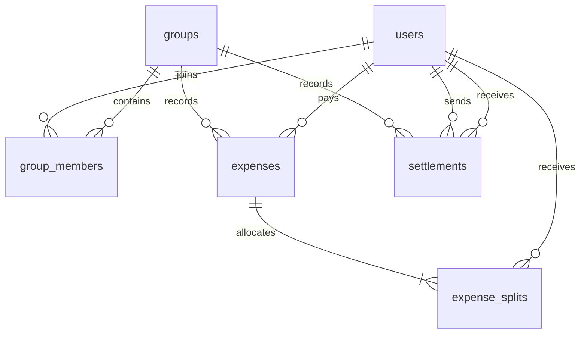

# Architecture and database design

## Request flow

The optional Together dashboard is served at `/` using `FileResponse`, with HTML, CSS, and JavaScript under `app/static/`. It calls the same JSON endpoints as Swagger and Postman; no duplicate financial logic or separate database is introduced. Its split preview uses integer paise, and the backend validates every write. The browser displays net settlement suggestions rather than asking users to interpret pairwise ledger cycles.

Pydantic validates request shape, types, precision, and custom split totals. Routes delegate business rules to services. SQLAlchemy uses parameterized queries and persists data inside a request transaction. Explicit response schemas validate returned data.

The application factory accepts a database URL so tests can use isolated on-disk SQLite databases. Startup calls `Base.metadata.create_all`. This initializes new databases; it does not migrate existing schemas.

## Schema



| Table | Fields and constraints |
| --- | --- |
| `users` | Integer primary key `id`; non-null `name`; UTC `created_at`. Names may repeat. |
| `groups` | Primary key `id`; non-null name, currency, timestamp; check restricts currency to INR. |
| `group_members` | Composite primary key `(group_id, user_id)`; group/user foreign keys; `joined_at`. |
| `expenses` | Primary key; group/payer foreign keys; positive bounded `amount_minor`; description, optional category, split type, UTC timestamp. Composite foreign key `(group_id, paid_by)` requires payer membership. |
| `expense_splits` | Composite primary key `(expense_id, user_id)`; expense/user foreign keys; nonnegative `amount_minor`. |
| `settlements` | Primary key; group/sender/recipient foreign keys; positive bounded amount; sender differs from recipient; composite membership foreign keys for both parties; UTC timestamp. |

An index on `(group_id, created_at, id)` supports expense history; `(group_id, id)` supports settlement history. Composite primary keys index memberships and shares. Foreign keys are enabled on every SQLite connection.

Saved shares are intentional historical data: reconstructing shares from current membership would change past expenses. Cross-row rules (share totals and participant membership) are enforced by services within the transaction. A CHECK constraint cannot validate a sum across multiple rows. Direct SQL writes bypassing services are outside the supported interface.

## Transactions

Reads explicitly begin a transaction so multi-query balance responses use a consistent snapshot. Writes issue `BEGIN IMMEDIATE` before validation reads. SQLite serializes writers, preventing membership/balance changes between validation and commit by another write.

Function-scoped dependency cleanup commits before the HTTP response is sent. Exceptions roll back the entire transaction. Saving an expense and its shares is atomic, including when a share insert fails.

The tradeoff is write throughput: SQLite allows one writer at a time. Lock waiting is capped at ten seconds; sustained contention can return 503. PostgreSQL would require a different concurrency strategy; replacing the database URL alone is insufficient because `BEGIN IMMEDIATE` is SQLite-specific.

## Balances

```text
net = amounts paid - allocated shares + settlements sent - settlements received
```

Positive means receivable, negative means payable. Every ledger event has equal and opposite effects, so group net balances sum to zero.

For pairwise balances, each non-payer share adds debt to the payer. Opposing debts between the same two IDs cancel. A recorded payment subtracts from that pair. Names are display fields only.

### Pairwise ledger versus net settlement

If A owes B INR 10 and B owes C INR 10, the net positions are A: -10, B: 0, C: +10. The suggested payment is A to C for INR 10.

After recording that payment, all positions are zero and `is_settled` is true. Pairwise entries form a cycle: A to B, B to C, C to A. The cycle has zero net effect and does not require further payments. Settlement suggestions correctly return an empty list.

These views are deliberately separate. The API preserves the ledger instead of rewriting expense shares or inventing intermediary payment records. Consumers use net positions and suggestions for payment decisions.

## Settlement algorithm

Derive net positions, sort debtors and creditors by descending amount (ID breaks ties), and match the current debtor/creditor for the smaller remaining balance. Advance whichever side reaches zero.

With `k` nonzero positions, at most `k - 1` payments are needed because each step clears at least one member and the last clears two. Sorting is `O(k log k)`; matching is `O(k)`. Reading the ledger is proportional to group expenses, shares, and payments. The greedy plan is not guaranteed globally minimal.

Payments may be recorded between any net debtor/creditor, even without a direct historical debt, provided neither net position is exceeded. This allows suggested payments to be recorded. Suggestions are read-only and deterministic.

## Scope

Single currency, synchronous SQLAlchemy, and a single service keep the solution focused. Simple user/group operations stay in routes; financial logic lives in services. No automatic creation of users/memberships occurs during expense creation. There are no edit/delete APIs or authentication; this is a trusted demo, not a public deployment.
